<p align="center">
  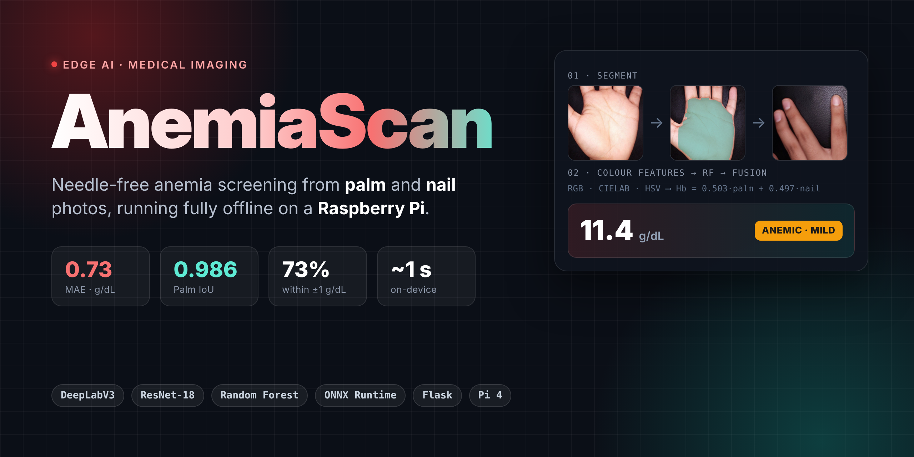
</p>

<p align="center">
  
  
  
  
  
  
  
</p>

<p align="center">
  <b>Take two photos → get a haemoglobin estimate and WHO anemia status in about a second.</b><br>
  No blood, no lab, no internet. Everything runs on a ₹9.6k Raspberry Pi box.
</p>

---

## ⚡ TL;DR

**Anemia affects more than 1 in 3 people worldwide**, but the standard test (a CBC) needs a blood draw, a lab and trained staff. **AnemiaScan** estimates haemoglobin (Hb) from **photographs of the palm and fingernails**:

1. a **DeepLabV3 + ResNet-18** network finds the palm and nail pixels,
2. **colour statistics** (RGB · CIELAB · HSV) are pulled from those regions,
3. two **Random Forests** predict Hb from the palm and from the nail,
4. an **inverse-MSE weighted fusion** combines them, and
5. **WHO sex-specific cut-offs** turn the number into *Normal / Mild / Moderate / Severe*.

The whole pipeline is exported to **ONNX** and served by a **Flask** app on a **Raspberry Pi 4** inside a light-sealed enclosure with a fixed LED, so every photo is taken under the same light.

| | |
|:--|:--|
| 🎯 **Hb error** | **MAE 0.734 g/dL** · RMSE 0.930 · r = 0.756 · 73.1 % within ±1 g/dL |
| 🩸 **Screening** | **AUC 0.736** (95 % CI 0.700–0.771) · NPV 0.811 |
| ✂️ **Segmentation** | **IoU 0.986** palm · 0.767 nail · 97.9 % of images routed correctly |
| 🧪 **Validation** | 823 subjects · 5 × 5-fold **subject-grouped** CV · Wilcoxon + Holm |
| 🔌 **Edge** | ~1 s per image · fully offline · photos never leave the device |

---

## 🧭 How it works

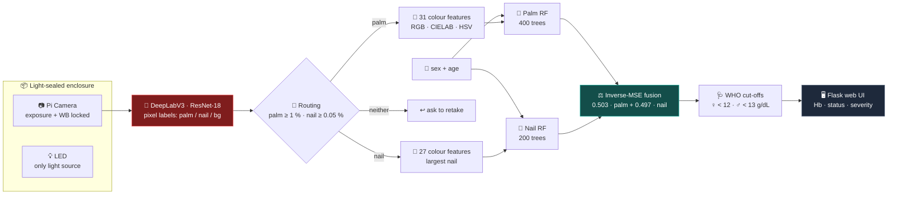

### One subject, end to end

A real example from the held-out data: a woman with a reference Hb of **11.4 g/dL**. The palm model says 11.41, the nail model says 11.36, the fusion gives **11.39**, and she's correctly flagged as **mild anemia**.

<p align="center">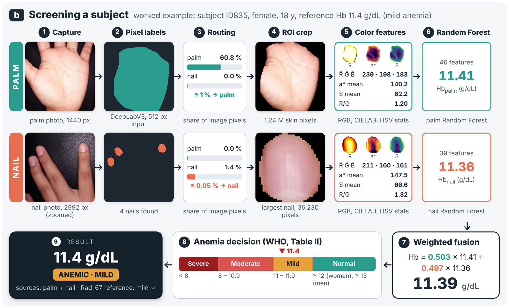</p>

---

## 🧠 Model

### Segmentation: one network, two regions

A single **DeepLabV3** head on an ImageNet **ResNet-18** encoder (output stride 8, ASPP rates 12/24/36) labels each pixel as *background*, *nail* or *palm*. It has 15.9 M parameters and was trained with cross-entropy + Dice loss, AdamW and a one-cycle schedule on a T4 GPU.

<p align="center">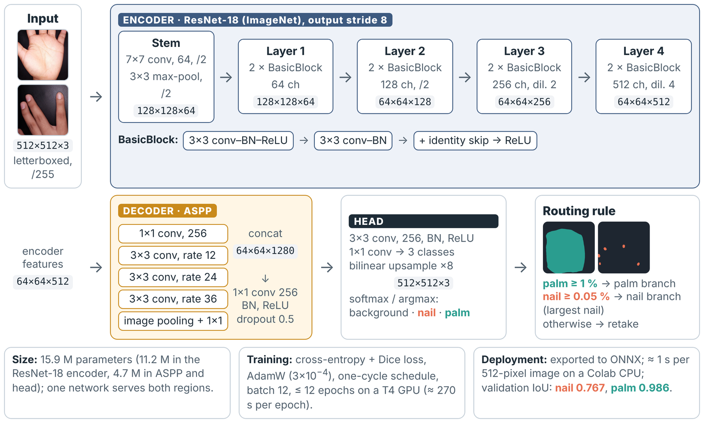</p>

<table><tr>
<td width="55%">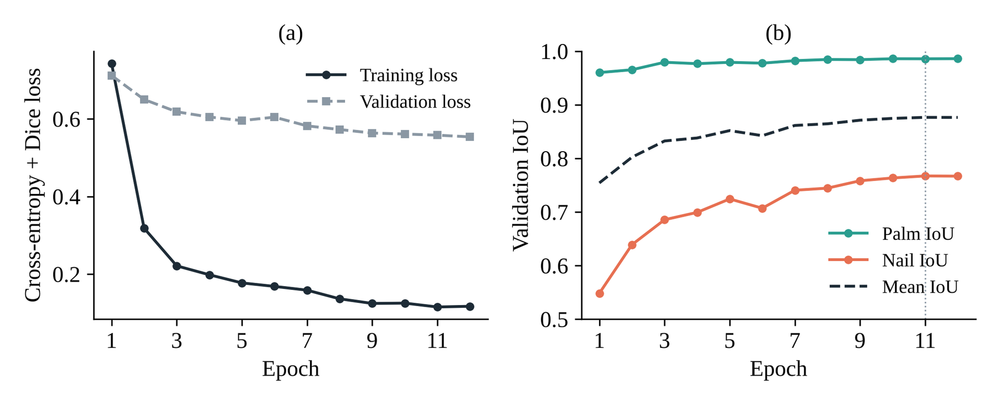</td>
<td>

| Metric | Palm | Nail |
|:--|:--:|:--:|
| **IoU** | **0.986** | **0.767** |
| **Dice** | 0.993 | 0.853 |
| Mean IoU | 0.877 | (both) |
| Routing accuracy | 97.9 % | of 857 images |

Nails are tiny (often < 2 % of the frame), which is why their IoU is lower. The routing rule only needs to find *enough* nail, not a perfect outline.

</td></tr></table>

### Hb regression and fusion

<table><tr>
<td width="45%">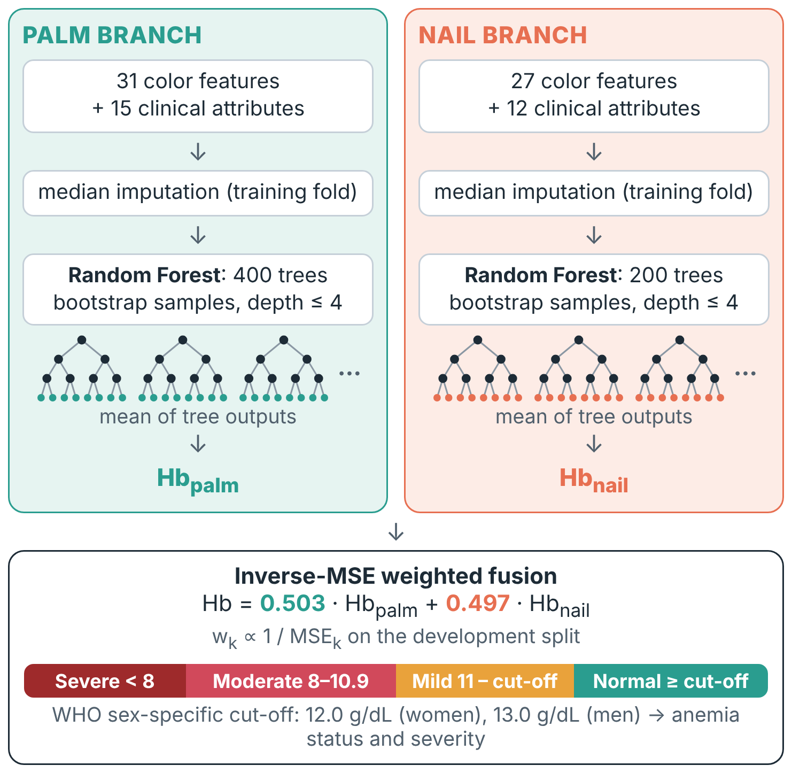</td>
<td>

- **Palm branch:** 31 colour features + 15 clinical attributes → Random Forest (400 trees, depth ≤ 4)
- **Nail branch:** 27 colour features + 12 clinical attributes → Random Forest (200 trees, depth ≤ 4)
- Shallow trees on purpose: with ~800 subjects, deep trees memorise.
- **Fusion weights** come from each branch's out-of-fold error: *w ∝ 1 / MSE*, giving 0.503 (palm) and 0.497 (nail).
- Missing values are imputed with training-fold medians only, so there's no leakage.

</td></tr></table>

### Development workflow

<p align="center">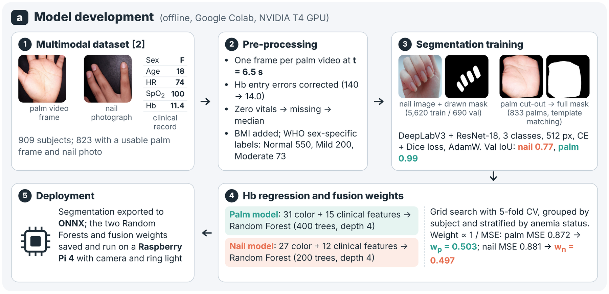</p>

---

## 📊 Results

All numbers are **out-of-fold** on **823 subjects**, using **5 × 5-fold cross-validation grouped by subject** (the same person never appears in train and test).

<table><tr>
<td width="50%">

**Hb estimation (weighted fusion)**

| Metric | Value |
|:--|:--:|
| MAE | **0.734 g/dL** |
| RMSE | 0.930 g/dL |
| R² | 0.571 |
| Pearson r | 0.756 |
| MAPE | 5.86 % |
| Within ±1 g/dL | **73.1 %** |

</td><td width="50%">

**Anemia screening**

| Metric | Value |
|:--|:--:|
| AUC | **0.736** (0.700–0.771) |
| Sensitivity | 0.683 |
| Specificity | 0.676 |
| NPV | **0.811** |
| Precision | 0.511 |
| Balanced accuracy | 0.679 |

</td></tr></table>

<p align="center">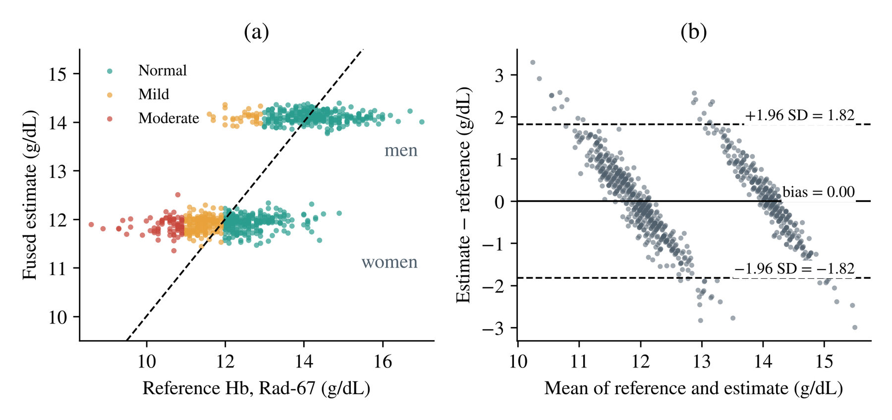<br>
<sub>(a) Fused estimate vs Rad-67 reference, coloured by WHO class. (b) Bland–Altman: bias 0.00 g/dL, 95 % limits of agreement ±1.82 g/dL.</sub></p>

### 🔬 Ablation, and an honest finding

<p align="center">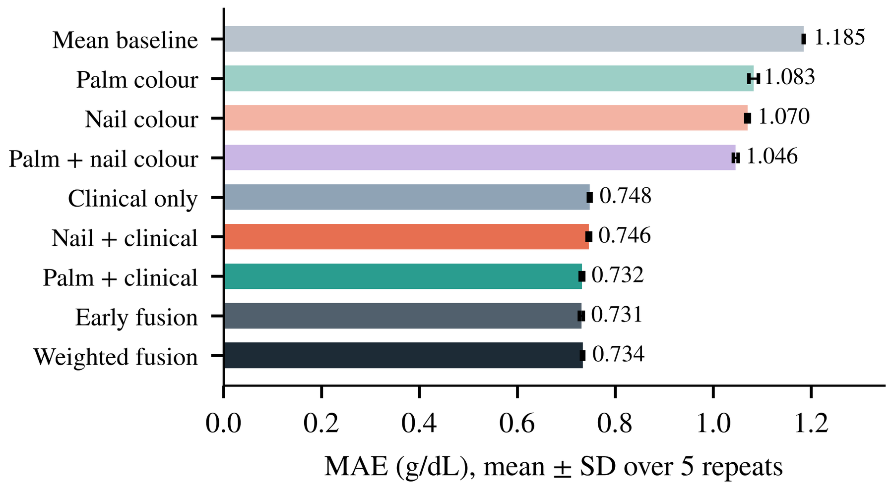</p>

| Comparison | MAE (g/dL) | Wilcoxon p | Verdict |
|:--|:--:|:--:|:--|
| Fusion vs nail model | 0.734 vs 0.746 | 0.004 | ✅ fusion better (survives Holm) |
| Palm + clinical vs clinical only | 0.732 vs 0.748 | 0.020 | small gain |
| Fusion vs palm model | 0.734 vs 0.732 | 0.50 | no difference |
| Fusion vs sex-specific mean | 0.734 vs 0.736 | 0.20 | no difference |

> **Key insight.** Colour on its own explains only **12–17 % of Hb variance**. Within women the correlation is r = 0.18; within men it's r = −0.03. Most of the apparent accuracy comes from **sex**, so a sex-specific mean is a surprisingly strong baseline. Many papers in this area report 94–99 % accuracy without testing against baselines like this. AnemiaScan does, and reports it. The right framing is a **screening aid**, not a blood test.

---

## 🛠️ Hardware

<table><tr>
<td width="62%">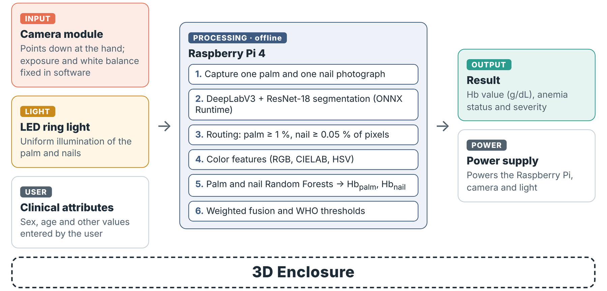</td>
<td>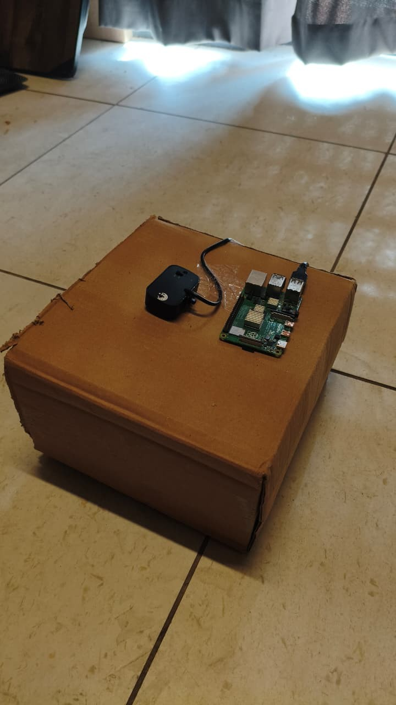</td>
</tr></table>

| Component | Role |
|:--|:--|
| **Raspberry Pi 4** | Runs segmentation, features, both forests and fusion (ONNX Runtime, CPU) |
| **Pi Camera module** | Looks down at the hand; exposure and white balance locked after warm-up |
| **LED** | The only light inside the box, for repeatable colour |
| **Enclosure** | Blocks room light; a strip curtain at the front lets the hand in |
| **microSD + 5 V USB-C** | OS, models, app and power |

**Bill of materials ≈ ₹9,600.** At ₹150 per lab test, it pays for itself after about 64 avoided tests.

---

## 🖥️ The app

<table><tr>
<td>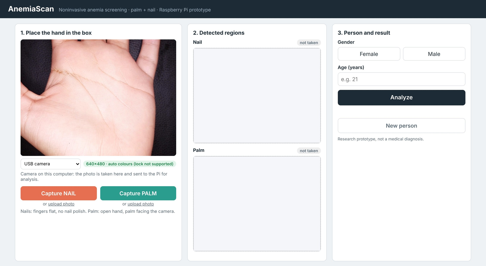<p align="center"><sub>Live view, capture nail and palm</sub></p></td>
<td>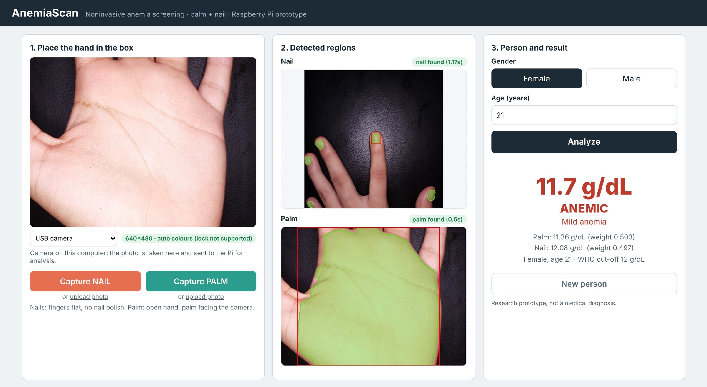<p align="center"><sub>Detected regions, Hb, status and severity</sub></p></td>
</tr></table>

- **Capture NAIL → Capture PALM → sex + age → Analyze.**
- Regions are outlined live, so you can see what the model used.
- Warns when palm and nail disagree by more than 1.5 g/dL, or when a region is missing.
- For users outside the training age range, Hb is adjusted with sex-specific age norms from **CDC NHANES 2015–2018** (n = 10,587).
- Starts automatically at boot (systemd) and is reachable from any phone or laptop on the same network at `http://<pi-ip>:5000`.

---

## 🚀 Quick start

```bash
git clone https://github.com/GiffyCOOL/AnemiaScan.git
cd AnemiaScan/app
```

**1. Get the models.** Run [`notebooks/Export_Models_for_Pi.ipynb`](notebooks/Export_Models_for_Pi.ipynb) on the trained PyTorch / scikit-learn models. It writes 4 ONNX files and a `config.json`, checks the ONNX outputs against the originals, and you copy them into `app/models/`. The weights are about 110 MB, so they aren't committed here.

**2. Try it on a laptop (upload photos).**

```bash
pip install -r requirements.txt
python app.py --no-camera --port 5050     # open http://localhost:5050
```

**3. Deploy on a Raspberry Pi 4 (64-bit Raspberry Pi OS).**

```bash
bash setup_pi.sh                                   # apt + venv + onnxruntime + checks
sudo cp anemiascan.service /etc/systemd/system/    # edit user/path first
sudo systemctl enable --now anemiascan             # starts on every boot
hostname -I                                        # → open http://<ip>:5000
```

Full hardware and wiring notes are in [`app/SETUP.md`](app/SETUP.md).

---

## 📁 Repository layout

```text
AnemiaScan/
├── app/                        # Raspberry Pi application
│   ├── app.py                  # Flask server: camera, LED, routes, age adjustment
│   ├── anemiascan_core.py      # segmentation → features → RF → fusion → WHO
│   ├── templates/index.html    # web UI
│   ├── export_models.py        # PyTorch / sklearn → ONNX
│   ├── setup_pi.sh             # one-shot Pi installer
│   ├── anemiascan.service      # systemd unit (autostart)
│   ├── led_test.py             # GPIO LED check
│   ├── *.command               # macOS helpers (test, deploy, tools)
│   └── models/                 # put the ONNX files + config.json here
├── notebooks/
│   ├── AnemiaScan_Inference_v3.ipynb   # Colab: photo → fused Hb → anemia
│   └── Export_Models_for_Pi.ipynb      # Colab: export + verify ONNX
└── assets/                     # figures used in this README
```

---

## 📚 Data

The models were trained on the open **noninvasive multimodal anemia dataset** (909 young adults; palm videos, nail photos and clinical data; Hb from a Masimo **Rad-67** pulse co-oximeter), released under **CC BY 4.0**. 823 subjects had both a usable palm frame and nail photo.

> M. A. Valles-Coral *et al.*, "Noninvasive multimodal dataset for the detection of iron deficiency anemia in young adults: fingertip videos, palm videos, and nail photographs," *Revista Científica de Sistemas e Informática*, 5(2), e955, 2025. doi:[10.51252/rcsi.v5i2.955](https://doi.org/10.51252/rcsi.v5i2.955)

The dataset is not redistributed here; download it from the source.

---

## 🗺️ Limitations and roadmap

- [ ] **Reference:** Hb from a pulse co-oximeter, not a lab CBC → collect venous / lab Hb.
- [ ] **Population:** young adults from one site → older and more diverse cohorts.
- [ ] **Colour:** camera-dependent → add a printed colour-reference card for calibration.
- [ ] **Model:** sex dominates → train separate models for men and women.
- [ ] **Field test:** the prototype hasn't been evaluated on participants yet.
- [x] Offline edge deployment, automatic ROI segmentation, multi-region fusion, rigorous validation.

---

> ⚠️ **Research prototype, not a medical device.** AnemiaScan is a screening aid and does not replace a blood test. Don't use it for diagnosis or treatment decisions.

<p align="center"><sub>Built at Thapar Institute of Engineering & Technology, Patiala · 2026</sub></p>
